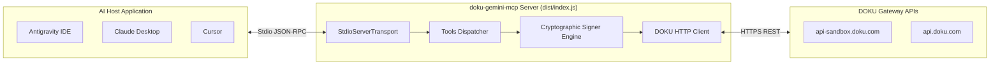

# DOKU Gemini MCP — Design & Skill Orchestration Document (BLUEPRINT.md)

**Project Name**: `doku-gemini-mcp`  
**Version**: 1.2.0  
**Status**: Ready for Execution  
**Architecture**: Full-Stack MCP Engine (TypeScript + tsup + Vitest)  
**Author**: Roedy Rustam  

---

## 1. Understanding Summary
- **Core Goal**: Membangun server Model Context Protocol (MCP v1.x) fungsional berbasis TypeScript yang mengompilasi ke `dist/index.js`, membersihkan artefak crash dump pada git, mensinkronisasikan versi manifest, melengkapi skrip otomasi mandiri di `scripts/`, dan menyiapkan unit test Vitest untuk kalkulasi signature Jokul v2 dan SNAP BI.
- **Target Audience**: AI Agents (Antigravity IDE, Claude Desktop, Cursor, Gemini CLI) dan pengembang payment gateway di ekosistem Indonesia.
- **Key Flows**: Autonomous checkout creation, Virtual Account issuance, QRIS generation, e-wallet charges, order inquiry, and refund execution via MCP tools.
- **Non-Goals**: Tidak bertindak sebagai database transaksional (server MCP bersifat stateless client/proxy menuju gateway resmi DOKU).

---

## 2. Technical Architecture & Skill Delegation



### Skill Delegation Matrix
| Phase / Layer | Specialized Skill / Subagent | Execution Scope |
|---|---|---|
| **MCP Server Core** | `ai-mcp-engineer`, `mcp-server-architect` | Merancang `src/index.ts`, mendefinisikan 7 core MCP tools dengan JSON Schema ketat. |
| **FinTech Cryptography** | `fintech-payment-sentinel`, `doku-payment-gateway` | Merancang `src/core/signer.ts`, memastikan rumus Jokul v2 & SNAP BI bebas regresi. |
| **Automation Scripts** | `js-backend-expert`, `agentic-coding-workflow-expert` | Mengembangkan `scripts/audit-doku.mjs`, `scripts/export-postman.mjs`, `scripts/test-sandbox.mjs`. |
| **Testing & Quality** | `quality-guardian`, `autonomous-tdd-debugger` | Menulis test suite Vitest untuk signature, webhook verification, dan input schema validation. |
| **CI/CD & Packaging** | `cloud-devops-sre`, `github-actions-expert` | Konfigurasi `package.json`, `tsup.config.ts`, `.github/workflows/ci.yml`. |

---

## 3. Directory Layout & File Structure

```text
doku-gemini-mcp/
├── .github/
│   └── workflows/
│       └── ci.yml                      # CI pipeline (lint, typecheck, test, build)
├── dist/                               # Compiled single-file bundle (tsup output)
│   └── index.js                        # Executable entry point (node dist/index.js)
├── docs/                               # 7 Technical documentation guides
├── rules/                              # Modular rules for AI assistants
├── scripts/                            # Executable agentic helper scripts
│   ├── audit-doku.mjs                  # Security & signature syntax scanner
│   ├── export-postman.mjs              # Postman Collection v2.1 exporter
│   ├── test-sandbox.mjs                # Live DOKU Sandbox API connectivity tester
│   └── detect-stack.mjs                # Tech stack auto-detector
├── skills/                             # 12 Specialized agentic skills (SKILL.md)
├── src/                                # TypeScript source code
│   ├── core/
│   │   ├── client.ts                   # DOKU API HTTP client with auto-signing
│   │   ├── constants.ts                # Endpoints, bank codes, and channel enums
│   │   ├── signer.ts                   # Jokul v2 & SNAP BI cryptographic signer
│   │   └── types.ts                    # TypeScript interfaces for requests & responses
│   ├── tools/                          # MCP tool handlers
│   │   ├── checkout.ts                 # create_checkout_payment & cancel_checkout_order
│   │   ├── virtual-account.ts          # create_virtual_account
│   │   ├── qris.ts                     # create_qris_payment
│   │   ├── ewallet.ts                  # create_ewallet_payment
│   │   ├── status.ts                   # check_transaction_status
│   │   └── refund.ts                   # process_refund
│   │   └── snap.ts                     # get_snap_b2b_token & create_snap_qris_payment
│   └── index.ts                        # MCP Server initialization & Stdio transport
├── tests/                              # Vitest unit test suite
│   ├── signer.test.ts                  # Cryptographic signature unit tests
│   ├── webhook.test.ts                 # Webhook verification & timingSafeEqual tests
│   └── tools.test.ts                   # MCP tool schema & execution tests
├── .gitignore                          # Cleaned gitignore with *.stackdump
├── AGENTS.md                           # Antigravity security rules
├── BLUEPRINT.md                        # This document
├── gemini-extension.json               # Synced version 1.2.0
├── LICENSE                             # MIT
├── mcp_config.json                     # Client configuration template
├── package.json                        # Scripts, dependencies, and metadata
├── plugin.json                         # Synced version 1.2.0
├── PRD.md                              # Formal Product Requirements Document
├── README.md                           # Master documentation
├── tsconfig.json                       # TypeScript compiler configuration
└── tsup.config.ts                      # Bundler configuration
```

---

## 4. Architectural Decision Records (MADR Standard)

| # | Decision Title | Status | Context & Problem | Chosen Solution & Rationale | Consequences & Trade-offs | Orchestrated Skill |
|---|---|---|---|---|---|---|
| **ADR-01** | Full-Stack MCP Engine Implementation | **Accepted** | Repositori sebelumnya hanya memuat petunjuk prompt tanpa executable code, menyebabkan `dist/index.js` missing. | Membangun implementasi TypeScript resmi dengan `@modelcontextprotocol/sdk` v1.x. | Mengharuskan `package.json` dan node_modules, tetapi membuat plugin benar-benar bisa dieksekusi. | `mcp-server-architect` |
| **ADR-02** | Bundling Tunggal via `tsup` | **Accepted** | Pengguna Claude Desktop / AGY memerlukan file JavaScript siap jalan tanpa konfigurasi kompilasi tambahan. | `tsup` menghasilkan single bundle CJS/ESM di `dist/index.js` dengan shebang `#!/usr/bin/env node`. | Waktu build < 1 detik, zero-config distribution. | `cloud-devops-sre` |
| **ADR-03** | Test Suite Kriptografis via Vitest | **Accepted** | Rumus HMAC DOKU sangat rentan terhadap trailing newline, format ms pada timestamp, dan urutan header. | Vitest unit test dengan 100% assertion pada rumus Digest dan Component String. | Memberikan jaminan matematis anti-regresi. | `quality-guardian` |
| **ADR-04** | Dual-Engine: Jokul API v2 & SNAP BI | **Accepted** | Merchant di Indonesia berada dalam masa transisi antara standar Jokul v2 dan BI SNAP v1.0. | Mendukung kalkulasi signature kedua standar dalam `src/core/signer.ts`. | Kode signer lebih lengkap dan fleksibel untuk semua channel pembayaran. | `fintech-payment-sentinel` |

---

## 5. Pre-Mortem Risk Assessment & Mitigation

| Potential Failure Point | Risk Level | Root Cause | Preventive Mitigation |
|---|---|---|---|
| **HTTP 401 Signature Mismatch** | High | Trailing `\n` pada string komponen atau timestamp menyertakan milidetik (`.123Z`). | `src/core/signer.ts` menggunakan regex ketat `.replace(/\.\d{3}Z$/, 'Z')` dan template string tanpa newline di akhir. Dilindungi unit test Vitest. |
| **Timing Side-Channel Vulnerability** | High | Menggunakan operator `===` untuk memvalidasi signature webhook incoming. | Menggunakan `crypto.timingSafeEqual(Buffer.from(a), Buffer.from(b))` dengan proteksi panjang buffer yang sama. |
| **Accidental Production Charge** | Critical | Default environment mengarah ke live gateway. | Hardcoded default `DOKU_IS_PRODUCTION=false` (Sandbox `api-sandbox.doku.com`) kecuali secara eksplisit di-set `"true"`. |
| **Leaking Secrets in Logs** | Medium | Meng-output `process.env` atau raw signature komponen ke stdout. | Semua log disanitisasi; tidak ada secret key yang dicetak ke console atau LLM context. |

---

## 6. Subagent Contract Map Slice (`CONTEXT_MAP.md` slice)

Berikut adalah kontrak tipe data TypeScript utama yang diwariskan ke subagent pelaksana:

```typescript
export interface DokuConfig {
  clientId: string;
  secretKey: string;
  isProduction: boolean;
}

export interface JokulSignatureParams {
  clientId: string;
  secretKey: string;
  requestId: string;
  timestamp: string; // ISO8601 without ms: YYYY-MM-DDTHH:mm:ssZ
  targetPath: string; // e.g. /checkout/v1/payment
  body?: object | string;
}

export interface SnapSignatureParams {
  httpMethod: 'GET' | 'POST' | 'PUT' | 'DELETE';
  endpointUrl: string;
  accessToken: string;
  secretKey: string;
  timestamp: string;
  body?: object | string;
}

export interface CheckoutPaymentPayload {
  order: {
    amount: number;
    invoice_number: string;
    currency?: string;
    callback_url?: string;
    line_items?: Array<{
      name: string;
      price: number;
      quantity: number;
    }>;
  };
  payment?: {
    payment_due_date?: number;
    payment_method_types?: string[];
  };
  customer?: {
    name?: string;
    email?: string;
    phone?: string;
  };
}
```


